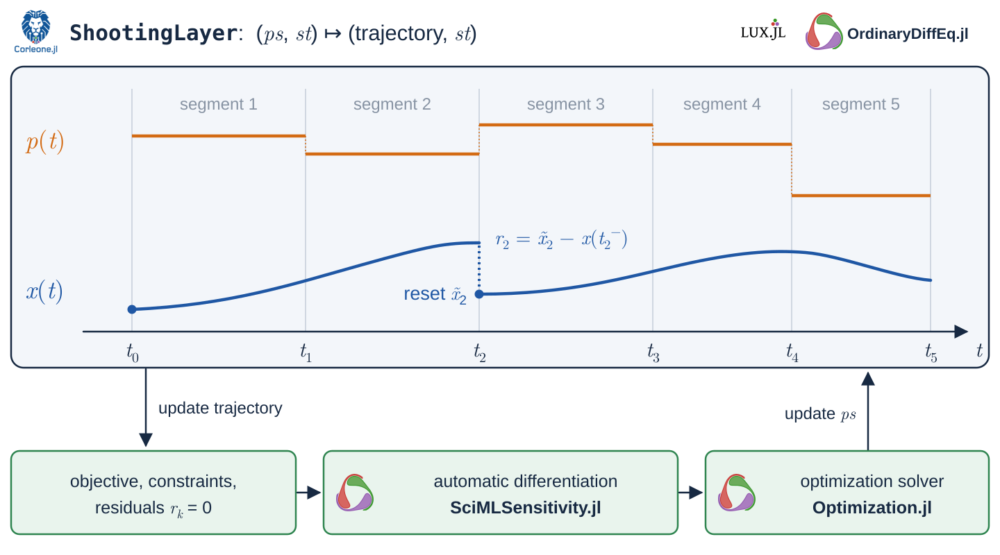

# [Single and multiple shooting](@id shooting_formulation)

A shooting method turns a continuous dynamic optimization problem into a
finite-dimensional one. The optimizer chooses parameter values and, optionally,
state values at chosen times; Corleone integrates the ODE between those times with
a SciML solver and hands the resulting trajectory to your objective and constraints.

## Dynamics and the integration grid

Corleone works with an ordinary `ODEProblem`

```math
\dot{x}(t)=f(x(t),p(t),t),\qquad
x(t)\in\mathbb{R}^{n_x},\quad p(t)\in\mathbb{R}^{n_p},\quad t\in[t_0,t_f],
```

where ``x`` is the state and ``p`` the parameter vector, including any controls.
Following SciML convention, the state is called `u` in code, so `trajectory.u`
holds samples of ``x``.

Pass the problem, a solver, and your [schedules](@ref scheduling_guide) to
[`ShootingLayer`](@ref). Corleone integrates piece by piece between the problem
endpoints, the parameter switching times, and any state resets. Setup caches the
sorted union of these times, ``t_0=\tau_0<\cdots<\tau_N=t_f``, in `st.timestops`.
A parameter switch only splits the integration; the state carries over unchanged.

## Single shooting

Without state resets, each piece starts where the previous one ended. This is
**single shooting**: the only optimization variables are the parameters, and the
trajectory is always continuous.

## Multiple shooting

**Multiple shooting** adds new optimization variables for the state at chosen
interior times. Annotate a state with `kind = Val(:variable)` and give it a grid:

```julia
Tunable(1; kind = Val(:variable), default = [0.5, 1.5]) => [1.0, 2.0]
```

At each such time ``\tau_k``, the next piece starts from the assigned value
``\tilde{x}_{i,k}`` instead of the incoming state. To recover a continuous trajectory,
Corleone adds the matching residual

```math
r_{i,k}=\tilde{x}_{i,k}-x_i(\tau_k^-),
```

and the optimizer drives it to zero. Before optimization the trajectory may
therefore have jumps. Multiple shooting usually makes unstable or long-horizon
problems easier to solve, and segments that reset every state can be
[solved in parallel](@ref parallel_shooting).



In the figure, ``t_1, \dots, t_4`` are switching times of the control, but only
``t_2`` is a shooting node: the state is reset to ``\tilde{x}_2`` there, and the
dotted jump is the residual ``r_2``.

Not every state annotation creates a residual:

| Assignment | Effect |
|---|---|
| No annotation | The state passes through unchanged. |
| Tunable value at ``t_0`` | A free initial value, with no residual. |
| Tunable value at an interior time | A shooting variable with a matching residual. |
| Constant value at an interior time | A prescribed reset, with no residual. |
| Value at ``t_f`` | No residual, since no segment follows. |

[`shooting_constraints`](@ref) returns all residuals, ordered by time and then by
state index, and [`get_number_of_shooting_constraints`](@ref) counts them without
solving. When you use [`CorleoneDynamicOptProblem`](@ref), they are added as
equality constraints automatically.

## [Shared parameters across segments](@id shooting_parameter_segments)

Adding shooting nodes does not split the parameter intervals: a parameter value
that spans several segments is shared between them. If each segment needs its own
copy, call [`add_parameter_segments!`](@ref) after setup. It splits the intervals at
full-state shooting boundaries, copies the existing values, and adds the equality

```math
d_{j,\ell}=p_{j,\ell}-p_{j,\ell-1}
```

for each new interval ``\ell``. These residuals follow the state residuals in
[`shooting_constraints`](@ref). Original switching times stay unconstrained, and
fixed parameters get no residuals. Call it **before** packing parameters, querying
bounds, or building an optimization model.

## [Integral costs](@id shooting_quadratures)

A running cost is handled by adding a quadrature state that integrates it:

```math
J=\Phi(x(t_f),p(t_f)) + \int_{t_0}^{t_f}L(x(t),p(t),t)\,dt,
\qquad \dot{q}=L(x,p,t),\quad q(t_0)=0,
```

so that ``J=\Phi(x(t_f),p(t_f))+q(t_f)``. In a numerical model you add ``q`` to the
dynamics yourself and mark it with `quadratures = [i]`; the ModelingToolkit
frontend does both for you. The [LQR tutorial](@ref linear_quad_reg) and the
[ModelingToolkit tutorial](@ref mtk) show the two approaches.

With multiple shooting, a quadrature is lifted like any other state. Its terminal
value equals the whole-horizon cost only once the matching residuals are zero.

## [Bounds and accuracy](@id shooting_bounds)

Bounds on annotations constrain **stored values**: parameter bounds apply to each
interval value, and state bounds apply to tunable initial and shooting values. They
are not path constraints. To limit a state over time, add a
[sampled constraint](@ref optimization_guide), and choose the sample
times densely enough for your application; no sampled check certifies what happens
between the samples.

Integration accuracy is set by the ODE solver's tolerances, and the optimizer's
tolerances decide when it stops. A successful return code does not prove a global
optimum. After optimizing, check the constraint residuals and, if needed, replay the
optimized controls in a single-shooting solve, as the [LTI tutorial](@ref mtk_lti)
does.
